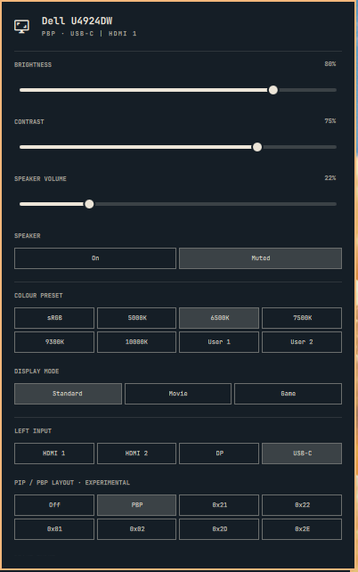

# Dell Display for Omarchy

A Dell Display Manager–style panel for the [Omarchy](https://omarchy.org/) bar.
It controls a Dell monitor over DDC/CI: brightness, contrast, speaker, colour
preset, display mode, inputs, PIP/PBP layout and the built-in KVM.



Built and tested on a **Dell U4924DW**. The standard controls (brightness,
contrast, volume, mute, colour preset, display mode, input) use standard
MCCS codes and should work on most Dell monitors. The PIP/PBP layout, right
input and KVM controls use Dell's undocumented manufacturer codes
(`0xE7`/`0xE8`/`0xE9`) and are marked **experimental**.

## Install

```bash
omarchy pkg add ddcutil
omarchy plugin add https://github.com/St1aan/omarchy-dell-display --enable
```

The widget lands on the right of the bar; move it with `omarchy bar move stiaan.dell-display`.

If the panel says **NOT RESPONDING OVER DDC**, check that `ddcutil detect` lists your
monitor. If it reports a permissions error, add yourself to the `i2c` group
(`sudo usermod -aG i2c $USER`) and log in again. DDC/CI also has to be enabled in
the monitor's OSD menu.

## Use

- **Click** the bar icon to open the panel; **scroll** on it to change brightness.
- **Keyboard:** `j`/`k` move between rows, `h`/`l` nudge a slider or walk a row's
  choices, `Enter` picks, `Esc` closes.
- Choices that would take *this* computer off-screen (e.g. switching the input
  away in full-screen mode) need a second click within 4 seconds.
- The right-input and KVM rows appear only while PIP/PBP is on.

## Settings

| Key     | Default | Meaning |
|---------|---------|---------|
| `model` | `""`    | Substring of the monitor's DDC model name (e.g. `U4924DW`). Blank uses the first Dell monitor found. |

```bash
omarchy bar set stiaan.dell-display model U4924DW
```

## Command-line helper

The panel talks to the monitor through the bundled `dell-display` script, which
you can also call from keybindings (it lives in
`~/.config/omarchy/plugins/stiaan.dell-display/`):

```bash
dell-display [--model NAME] state            # all settings as JSON
dell-display [--model NAME] set CODE VALUE   # e.g. set 10 70  (brightness 70%)
```

Calls are serialized with a lock, because overlapping DDC transactions garble
each other. Only the VCP codes the panel uses are accepted.

## Help identify the PBP layouts

Only `0x00` (off) and `0x24` (PBP) are identified. The other layout values the
U4924DW advertises (`0x21`, `0x22`, `0x01`, `0x02`, `0x2D`, `0x2E`) are shown by raw
code. If you find out what one does on your monitor, please open an issue or a
PR against `Model.js`.

## Licence

MIT
